# 01 Concurrency basics

**Coroutine** vs **task**, and why `gather` makes things concurrent.

| | Coroutine | Task |
|---|---|---|
| Created by | Calling an `async def` function: `work(1)` | `asyncio.create_task(work(1))`, `gather`, `TaskGroup` |
| Runs | Only when awaited, right now, inside your own flow | At your next suspension point, on the loop |
| Await more than once? | No (same object) | Yes, the result is stored on the task |
| Cancel or inspect? | No | `cancel()`, `done()`, `result()` |

- `work(1)` only creates a coroutine object. Nothing runs.
- `await coro` runs it inline: sequential.
- `create_task(coro)` puts it on the ready queue. It starts when you next suspend.
- `gather(*coros)` wraps each coroutine in a task, schedules all, and returns the results in input order.

```python
results = [await work(n) for n in (1, 2, 3)]            # ~6 s: one after another
results = await asyncio.gather(*(work(n) for n in (1, 2, 3)))   # ~3 s: waits overlap
```

Awaiting inside the loop (`for ...: results.append(await create_task(...))`) is sequential again. Create all the tasks first, then wait.



Run: `python3 concurrent_sleep.py`. Animation: [event_loop.html](../assets/event_loop.html).
