# 03 Semaphore

A counter that limits how many tasks can be **inside a block** at once.

```python
sem = asyncio.Semaphore(5)

async def download(url):
    async with sem:                 # 5 get in; the others suspend here
        return await client.get(url)
```

- All tasks are created and start. Only the guarded block is limited.
- Waiting tasks cost nothing: they sit on the semaphore, not in the ready queue.
- The slot is released on exit, even when the block raises.
- It caps how many are **in flight**, not how many **per second**. For a requests-per-second quota, space out the starts or use a rate limiter.
- Other uses: `Semaphore(0)` as a go-ahead signal; `Lock` is a semaphore with a limit of 1.



Run: `python3 semaphore_limit.py` (10 tasks, limit 5, about 2 s).
