# asyncio reference

Working notes and runnable examples. One folder per concept, each with a short README and code you can run.

## The model in five lines

- **One thread, one event loop.** The loop keeps a queue of tasks that are ready to run.
- A task runs until it hits an `await` on something unfinished, then suspends. The loop runs the next ready task.
- When the awaited thing completes (response, timer, queue item), the task rejoins the queue and resumes on the same line.
- asyncio doesn't make any single call faster. It **uses the waiting time** for other tasks.
- It helps with many independent IO waits. It does nothing for CPU-bound work (use processes) and breaks if you block the loop.



## Concepts

| Folder | Covers | Files |
|---|---|---|
| [01_concurrency_basics](01_concurrency_basics) | Coroutine vs task, `gather`, sequential vs concurrent | `concurrent_sleep.py` |
| [02_gather_and_taskgroup](02_gather_and_taskgroup) | Handling failures: `return_exceptions` vs `TaskGroup` | `gather_failures.py`, `taskgroup_failures.py` |
| [03_semaphore](03_semaphore) | Limiting concurrency | `semaphore_limit.py` |
| [04_timeout_and_cancellation](04_timeout_and_cancellation) | `asyncio.timeout`, `cancel()`, `CancelledError` | `timeout_cancel.py`, `cancellation.py` |
| [05_queue](05_queue) | Producer / consumer, `join`, `task_done` | `producer_consumer.py` |
| [06_blocking_calls](06_blocking_calls) | Why blocking freezes the loop, `to_thread` | `to_thread.py` |
| [07_event_and_lock](07_event_and_lock) | `Event`, `Lock`, races across an `await` | `event_gate.py`, `lock_counter.py` |
| [08_async_context_and_generators](08_async_context_and_generators) | `async with`, `async for` | `async_context_manager.py`, `async_generator.py` |
| [09_process_pool](09_process_pool) | CPU-bound work, `run_in_executor`, threads vs processes | `process_pool.py` |
| [10_event_loop_internals](10_event_loop_internals) | A mini event loop in about 60 lines | `mini_event_loop.py` |
| [profiling](profiling) | Profiling with Scalene | |

Also: [cheatsheet.md](cheatsheet.md) (everything on one page) and [exercises.md](exercises.md) (the problems and where each solution lives).

## Interactive animations

Open these in a browser (they need `assets/animation.css` next to them):

- [event_loop.html](assets/event_loop.html): ready queue, thread and waiting area, step by step
- [process_pool.html](assets/process_pool.html): jobs, one shared queue, a pool of workers
- [process_pool_vs_cores.html](assets/process_pool_vs_cores.html): what happens when workers outnumber cores

## Running

```bash
python3 01_concurrency_basics/concurrent_sleep.py
```

Python 3.11+ (`asyncio.timeout`, `TaskGroup`, `except*`).

## Pitfalls that cost time

- `work(1)` alone does nothing. Await it or make it a task.
- Awaiting inside the loop makes it sequential: `for x in xs: await f(x)`.
- A blocking call (`time.sleep`, `requests.get`) freezes every task.
- `to_thread(fn(x))` calls `fn` immediately. Write `to_thread(fn, x)`.
- Don't swallow `CancelledError`; re-raise it.
- `return_exceptions=True` hides errors unless you inspect the results.
- Never name a file after a standard-library module (`queue.py`, `asyncio.py`, `time.py`): it shadows the real one and breaks imports in unrelated code.
# asynchronous-programming
