# asyncio cheat sheet

## The model

- **One thread, one event loop.** The loop keeps a queue of tasks that are ready to run.
- A task runs until it hits an `await` on something **unfinished**, then it suspends and the loop runs the next ready task.
- When the awaited thing completes (response arrived, timer expired), the task rejoins the queue.
- asyncio doesn't make any single IO call faster. It **uses the waiting time** for other tasks.
- It only helps with many independent IO waits, and only if the code inside is truly async.

## Coroutine vs task

| | Coroutine | Task |
|---|---|---|
| Created by | Calling an `async def` function: `work(1)` | `asyncio.create_task(work(1))`, or `gather` / `TaskGroup` |
| Runs | Only when awaited, right now, inside your own flow | Starts at your next suspension point, on the loop |
| Concurrent with your code? | No | Yes |
| Await more than once? | No (same object) | Yes, the result is stored on the task |
| Cancel or inspect? | No | `cancel()`, `done()`, `result()` |

```python
c = work(1)                       # nothing has run yet
await c                           # runs now; awaiting c again raises RuntimeError

t = asyncio.create_task(work(1))  # scheduled, not started
await t                           # suspends until done, returns the result
await t                           # instant: reads the stored result
```

A task is created when you call `create_task` (it joins the queue then), not when you await it.

## Sequential vs concurrent

```python
# Sequential: each await finishes before the next starts (~3 waits)
a = await fetch("London")
b = await fetch("Paris")
c = await fetch("Rome")

# Concurrent: schedule everything, then wait once (~1 wait)
tasks = [asyncio.create_task(fetch(n)) for n in names]
results = await asyncio.gather(*tasks)          # same as gather(*coros) directly
```

Awaiting inside the loop makes it sequential again:

```python
for n in names:
    results.append(await asyncio.create_task(fetch(n)))   # sequential
```



## gather

- Wraps each coroutine in a task, schedules all, returns **one future**. Your `await` is what suspends you.
- Results come back **in input order**, not completion order.
- Unpack a list of inputs with `*`: `await asyncio.gather(*(fetch(n) for n in names))`.

| Variant | If one task fails |
|---|---|
| `gather(...)` | Raises the first error; the other tasks keep running |
| `gather(..., return_exceptions=True)` | Never raises; failures appear in the result list |
| `async with asyncio.TaskGroup()` (3.11+) | Cancels the rest, raises an `ExceptionGroup` |

```python
results = await asyncio.gather(*coros, return_exceptions=True)
for name, r in zip(names, results):
    if isinstance(r, Exception):
        print(name, "failed:", r)
```

## TaskGroup (3.11+)

Replaces `gather` for "all or nothing" work. The tasks live inside an `async with` block.

```python
async with asyncio.TaskGroup() as tg:
    t1 = tg.create_task(work(1))      # scheduled right away
    t2 = tg.create_task(work(2))
# block exit waits until every task in the group is done

print(t1.result(), t2.result())       # instant: reads the stored results
```

- `tg.create_task(...)` is `create_task` plus registration with the group.
- **Leaving the block is the wait.** `async with` awaits the group's `__aexit__`, so there is no `await` line.
- No list is returned. Keep the task objects and call `t.result()` **after** the block (it raises if the task isn't done; `await t` is the form that waits).
- Nothing is left running after the block, and no error is lost.

If a task raises, or the body of the block raises:
1. the group cancels all the other tasks and waits for them to stop;
2. the block exits by raising an `ExceptionGroup` (catch with `except*`, not `except`).

```python
try:
    async with asyncio.TaskGroup() as tg:
        tasks = [tg.create_task(work(i)) for i in range(5)]   # task 3 raises after 0.5 s
except* ValueError as eg:
    print("failed:", [repr(e) for e in eg.exceptions])

for i, t in enumerate(tasks):
    if t.cancelled():
        print(i, "cancelled")                 # check this first: t.exception() raises on a cancelled task
    elif t.exception() is not None:
        print(i, "failed:", t.exception())
    else:
        print(i, "->", t.result())
```

| | `gather(return_exceptions=True)` | `TaskGroup` |
|---|---|---|
| When one task fails | The others finish; failure is a value in the list | The others are **cancelled**; failure raised as `ExceptionGroup` |
| Results | List in input order | From each task object |
| Use when | Partial results are useful | One failure makes the rest pointless |

## Blocking calls

A sync call inside a coroutine holds the thread until it returns. Nothing else runs meanwhile.

```python
async def bad():
    time.sleep(2)                  # freezes the whole loop
    requests.get(url)              # same

async def good():
    await asyncio.sleep(2)
    await client.get(url)          # async client (httpx.AsyncClient, aiohttp)
    await asyncio.to_thread(blocking_fn, arg)   # blocking IO you can't replace
```

- CPU-heavy work: use a process pool (`loop.run_in_executor(process_pool, fn)`), not a thread.
- Debug: `asyncio.run(main(), debug=True)` warns about steps that hold the loop for more than 0.1 s.

## Semaphore

A counter that limits how many tasks can be **inside a block** at once.

```python
sem = asyncio.Semaphore(5)

async def download(client, url):
    async with sem:                       # 5 get in; the rest suspend here
        r = await client.get(url)
        return r.content                  # slot is released on exit, even on error
```

- All tasks are created and start. Only the guarded block is limited.
- Waiting tasks cost nothing; they are not in the ready queue.
- It caps **how many are in flight**, not **how many per second**. For a requests-per-second quota, space out the starts or use a rate limiter (for example `aiolimiter`).
- Other uses: `Semaphore(0)` as a go-ahead signal between tasks; `Lock` is a semaphore with a limit of 1.



## Asyncio vs threads vs processes

| | asyncio | Threads | Processes |
|---|---|---|---|
| Parallel Python code? | No (one thread) | No (GIL) | Yes |
| Switches at | `await` only | Any point | OS decides |
| Best for | Many IO waits, async libraries | Blocking IO libraries | CPU-bound pure Python |
| Cost | Tiny per task | Small | Large (startup, pickling) |

## Pitfalls

- `work(1)` alone does nothing. Await it or make it a task, or Python warns "coroutine was never awaited".
- Keep a reference to tasks you create; a task nobody refers to can be garbage-collected mid-run.
- Don't swallow `CancelledError`; re-raise it after cleanup.
- `t.result()` on an unfinished task raises; only `await t` waits.
- A shared counter is still racy if an `await` sits between the read and the write; use `asyncio.Lock`.
- `await` at the top level only works in a notebook. In a script use `asyncio.run(main())`.

## Quick checks

1. Three `await asyncio.sleep(1)` in a row take about 3 s; three tasks gathered take about 1 s.
2. 10 tasks through `Semaphore(5)` that each sleep 1 s take about 2 s.
3. Three coroutines that each call `time.sleep(1)` take about 3 s even under `gather`.
